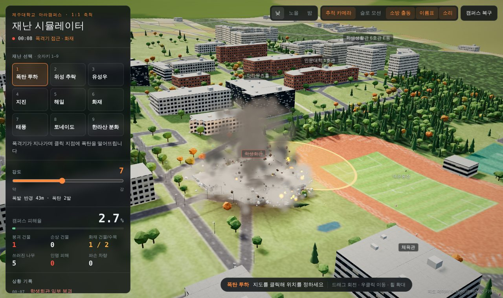
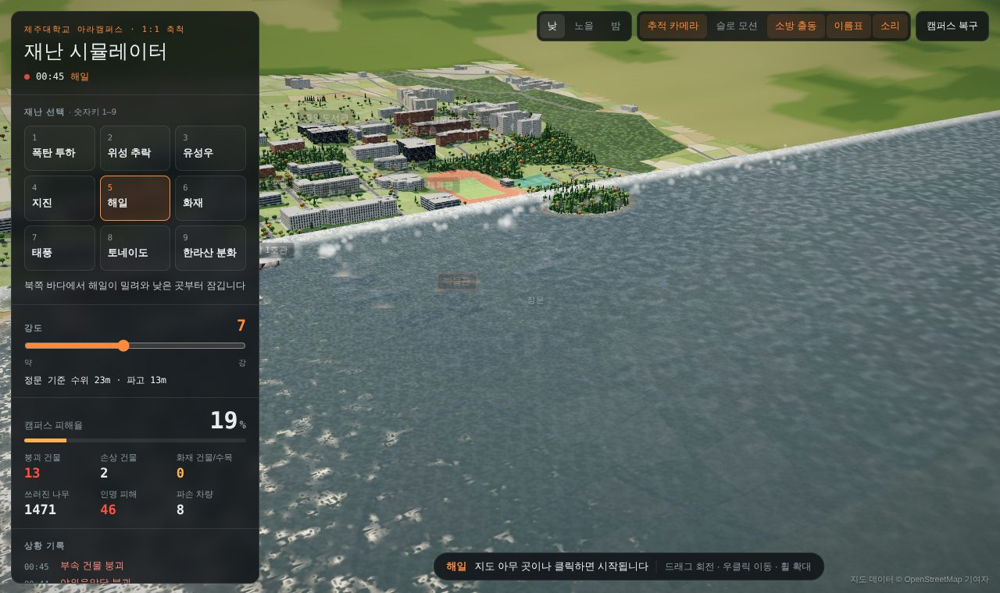
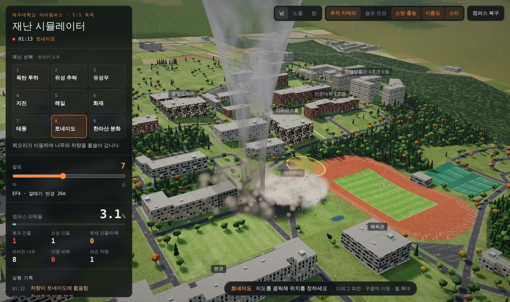

# 제주대 캠퍼스 재난 시뮬레이터

제주대학교 아라캠퍼스를 **실제 건물 배치(OpenStreetMap)와 실측 고도**로 3D 재현하고, 그 위에서 **9가지 재난**을 원하는 위치·강도로 일으켜 건물이 무너지고 불이 번지고 사람과 차량이 피하는 과정을 관찰하는 웹 시뮬레이터입니다. 설치 없이 브라우저에서 바로 실행됩니다.


| 폭탄 투하 | 지진 | 해일 |
|---|---|---|
|  |  |  |
| **토네이도** | **화재** | **한라산 분화** |
|  |  |  |

---

## 1. 실행 방법

실행 플랫폼은 **웹 브라우저**입니다. 크롬 또는 엣지 최신 버전을 권장합니다 (WebGL 필요).

### 방법 A. 웹에서 바로 실행

**https://gaogang1011.github.io/jnu-disaster-sim/**

### 방법 B. 내려받아 파일로 실행 (인터넷 없이도 동작)

1. 이 저장소에서 `Code → Download ZIP`으로 내려받아 압축을 풉니다.
2. 폴더 안의 `index.html`을 더블클릭하거나 브라우저 창에 끌어다 놓습니다.

three.js를 `vendor/three`에 포함해 두어서 외부 CDN 없이 동작합니다. 글꼴만 인터넷이 없으면 시스템 글꼴로 대체됩니다.

### 방법 C. 로컬 서버로 실행 (Node.js 18 이상)

```bash
git clone https://github.com/gaogang1011/jnu-disaster-sim.git
cd jnu-disaster-sim
npm start          # http://localhost:8080
```

`npm start`는 외부 패키지 없이 Node 내장 모듈만으로 정적 파일을 제공합니다.

### 화질 옵션

| 주소 | 설명 |
|---|---|
| `index.html` | 화면 크기로 자동 결정 (휴대폰 크기면 저화질) |
| `index.html?quality=low` | 저화질 강제. 노트북 내장 그래픽에서 끊기면 사용 |
| `index.html?quality=high` | 고화질 강제 |

실행 중에도 프레임이 느려지면 불꽃·연기 파티클 양을 자동으로 줄입니다.

---

## 2. 사용법

1. 왼쪽 패널에서 재난을 고릅니다 (숫자키 `1`~`9`).
2. 강도 슬라이더(1~10)로 규모를 정합니다. 슬라이더 아래에 반경·규모·지속 시간이 표시됩니다.
3. 지도 위에 마우스를 올리면 영향 범위가 원으로 표시되고, **클릭한 위치**에서 재난이 시작됩니다.
4. 왼쪽 아래 **피해 현황**과 **상황 기록**에서 결과를 확인합니다.
5. 오른쪽 위 **캠퍼스 복구**를 누르면 처음 상태로 돌아갑니다.

| 조작 | 동작 |
|---|---|
| 왼쪽 클릭 | 선택한 재난 실행 |
| 왼쪽 드래그 | 시점 회전 |
| 오른쪽 드래그 | 시점 이동 |
| 휠 / 핀치 | 확대·축소 |
| 숫자키 1~9 | 재난 선택 |
| 건물 위에 마우스 | 건물 이름·층수·구조 건전도·상태 표시 |

| 토글 (오른쪽 위) | 설명 |
|---|---|
| 낮 / 노을 / 밤 | 시간대 전환. 밤에는 창문과 가로등이 켜짐 |
| 추적 카메라 | 낙하체·토네이도를 자동으로 따라감 (직접 조작하면 해제) |
| 슬로 모션 | 시뮬레이션 속도를 0.28배로 |
| 소방 출동 | 불이 나면 소방차가 정문으로 진입해 물을 뿌려 진화 |
| 이름표 | 주요 건물 이름 표시. 붕괴하면 취소선 |
| 소리 | 절차적으로 합성한 폭발음·붕괴음·천둥·사이렌 |

---

## 3. 재난 9종

| 키 | 재난 | 동작 | 강도가 바꾸는 것 |
|---|---|---|---|
| 1 | 폭탄 투하 | 폭격기가 날아와 클릭 지점에 폭탄을 떨어뜨림. 화구·충격파·크레이터·파편 | 폭발 반경 18~56m, 폭탄 1~3발 |
| 2 | 위성 추락 | 플라스마 꼬리를 끌며 재진입, 공중 분해 후 본체와 파편 3개가 충돌 | 충돌 반경 32~81m |
| 3 | 유성우 | 운석이 지정 범위에 시차를 두고 쏟아짐. 일부는 대형 운석 | 운석 7~25개, 범위 106~250m |
| 4 | 지진 | 진앙에서 지표파가 퍼지며 땅이 물결침. 균열, 가스 누출 화재, 여진 | 규모 4.6~8.6, 지속 7~14초 |
| 5 | 해일 | 북쪽에서 파도가 밀려와 낮은 곳부터 잠긴 뒤 물이 빠짐 | 수위와 파고 |
| 6 | 화재 | 클릭 지점에서 발화, 바람을 따라 숲과 건물로 번짐 | 발화 범위, 풍속 |
| 7 | 태풍 | 폭우·돌풍·낙뢰. 나무가 쓰러지고 옥상 설비가 날아감, 높은 건물에 낙뢰 | 최대 풍속, 지속 시간 |
| 8 | 토네이도 | 이동하는 깔때기가 나무·차량을 빨아올리고 건물을 부숨 | EF 등급, 깔때기 반경 |
| 9 | 한라산 분화 | 한라산에서 분연이 솟고 화산탄이 캠퍼스에 떨어짐, 하늘이 화산재로 어두워짐 | 낙하 범위, 지속 시간 |

재난은 겹쳐 쓸 수 있습니다. 예를 들어 지진으로 건물을 약하게 만든 뒤 태풍을 보내면 손상된 건물이 먼저 무너집니다.

### 피해는 이렇게 계산됩니다

- 건물은 OSM 외곽선을 26m 격자로 나눈 **구역 단위**로 체력을 가집니다. 그래서 큰 건물은 한쪽만 무너질 수 있습니다.
- 폭발 피해는 중심에서 멀어질수록 줄어들고, 외벽 양식(현무암·벽돌·커튼월·주택 등)에 따라 내구도가 다릅니다.
- 한 구역이 무너지면 이웃 구역에 추가 피해를 줘 **연쇄 붕괴**가 일어날 수 있습니다.
- 지진은 층수가 높을수록, 해일은 낮은 지대·저층 주택일수록, 태풍은 주택일수록 피해가 큽니다.
- 불은 바람이 부는 쪽으로 더 멀리 번지고, 비가 오거나 물에 잠기면 꺼집니다.
- 보행자는 위험 지점에서 반대 방향으로 달아나고, 해일 때는 권제오름 방향으로 대피합니다.

---

## 4. 캠퍼스는 어떻게 재현했나

| 요소 | 출처 | 정확도 |
|---|---|---|
| 건물 84동의 외곽선·위치·이름 | OpenStreetMap | 실제 |
| 도로 116개, 인도·계단 | OpenStreetMap | 실제 |
| 숲·잔디·주차장·대운동장·테니스장·아라연 | OpenStreetMap | 실제 |
| 지형 고도 | 41×41 고도 격자 (1.7km 범위, 약 42m 간격) | 실측 기반, 보간 |
| 건물 높이 | 건물 이름으로 추정 (생활관 5~9층, 강의동 3~5층 등) | **추정** |
| 나무 한 그루씩의 위치 | OSM 구역 안에 무작위 배치 | 추정 |
| 캠퍼스 밖 (밭, 마을, 한라산, 오름, 시내 불빛) | 분위기 연출용으로 생성 | 실제와 다름 |

OSM에는 층수 정보가 거의 없어서 건물 높이는 `src/04-buildings.js`의 `buildingSpec()`에서 이름으로 정합니다. 실제와 다른 건물은 이 함수만 고치면 됩니다.

지도 데이터 © [OpenStreetMap 기여자](https://www.openstreetmap.org/copyright) (ODbL)

---

## 5. 구조

```
jnu-disaster-sim/
├─ index.html            진입점. vendor → src 순서로 스크립트 로드
├─ css/style.css         UI 스타일
├─ src/
│  ├─ 00-data.js         OSM 캠퍼스 데이터
│  ├─ 01-util.js         다각형·노이즈·난수 유틸
│  ├─ 02-core.js         렌더러, 카메라, 시간대, 하늘, 후처리
│  ├─ 03-terrain.js      지형, 지표 텍스처, 크레이터·그을림
│  ├─ 04-buildings.js    건물 생성·피해·붕괴·화재
│  ├─ 05-vegetation.js   수목, 가로등, 산불 확산
│  ├─ 06-particles.js    불꽃·연기·불티 파티클, 충격파
│  ├─ 07-debris.js       파편 물리
│  ├─ 08-agents.js       보행자, 차량, 소방차
│  ├─ 09-sound.js        Web Audio 절차적 사운드
│  ├─ 10-environment.js  해일 물, 비, 번개, 화산
│  ├─ 11-disasters.js    재난 9종과 등록표 DISASTERS
│  └─ 12-main.js         UI, 입력, 카메라 추적, 메인 루프
├─ vendor/three/         three.js r128 (오프라인 실행용)
├─ scripts/
│  ├─ serve.mjs          로컬 서버 (npm start)
│  └─ bundle.mjs         단일 HTML 생성 (npm run bundle)
├─ test/
│  ├─ data.test.mjs      데이터 검증 (npm test)
│  └─ e2e/run.mjs        브라우저 동작 테스트 (npm run test:e2e)
├─ docs/screenshots/     README 이미지 (E2E 테스트가 생성)
├─ SKILL.md              이 프로젝트를 다루는 AI 에이전트용 스킬
└─ TODO.md               단계별 진행표
```

**빌드 단계가 없습니다.** `src/*.js`는 모듈 번들러 없이 일반 `<script>`로 번호 순서대로 로드되고 전역 스코프를 공유합니다. 그래서 파일을 내려받아 더블클릭만 해도 실행되고, 코드를 고친 뒤 새로고침하면 바로 반영됩니다.

### 한 프레임의 흐름


### 기술 스택

- **three.js r128**: 3D 렌더링, 인스턴싱(수목 수천 그루, 파편), 셰이더(하늘·물·지형·토네이도), UnrealBloom 후처리
- **Canvas 2D**: OSM 구역·도로를 그린 2048px 지표 텍스처, 건물 외벽 텍스처 절차 생성
- **Web Audio API**: 음원 파일 없이 노이즈·오실레이터로 소리 합성, 거리에 따른 음속 지연
- **순수 JavaScript**: 프레임워크·번들러 없음

---

## 6. 테스트

```bash
npm test             # 데이터 검증 6건, 외부 패키지 없음
npm install && npx playwright install chromium
npm run test:e2e     # 헤드리스 크롬 동작 테스트
npm run screenshots  # 위 테스트 + docs/screenshots 이미지 갱신
```

**데이터 검증 (`test/data.test.mjs`)**: 건물 다각형 유효성, 주요 건물이 캠퍼스 경계 안에 있는지, 고도 격자 형식, 건물 분할 시 면적 보존(오차 3% 이내), 거리 계산.

**브라우저 동작 테스트 (`test/e2e/run.mjs`)**: `index.html`을 파일로 직접 열고 네트워크를 모두 차단한 상태에서

1. 로딩이 끝나고 건물 84동이 생성되는지
2. 지도를 실제로 마우스 클릭했을 때 재난이 실행되는지
3. 재난 9종을 학생회관에 강도 7로 일으켜 각각 시작 로그가 남고, 폭발·지진·토네이도류는 실제로 건물이 손상되는지
4. 캠퍼스 복구 후 모든 건물이 원래 상태로 돌아오는지
5. 전 과정에서 스크립트 오류가 없는지

를 확인합니다.

최근 실행 결과 (헤드리스 크롬, 소프트웨어 렌더링):

```
PASS  페이지 로드와 초기화
PASS  건물 84동 생성
PASS  지도 클릭으로 재난 실행
PASS  재난: bomb — 로그 "폭격기 진입", 손상 구역 6
PASS  재난: satellite — 로그 "위성 충돌", 손상 구역 12
PASS  재난: meteor — 로그 "유성우", 손상 구역 6
PASS  재난: quake — 로그 "지진 발생", 손상 구역 231
PASS  재난: flood — 로그 "해일 경보"
PASS  재난: fire — 로그 "화재 발생", 화재 구역 6
PASS  재난: typhoon — 로그 "태풍 상륙"
PASS  재난: tornado — 로그 "토네이도 발생", 손상 구역 8
PASS  재난: volcano — 로그 "한라산 분화"
PASS  캠퍼스 복구
PASS  실행 중 스크립트 오류 없음

14/14 통과
```

README의 스크린샷은 모두 이 테스트가 찍은 화면입니다.

---

## 7. 개발 과정

이 프로젝트는 바이브 코딩으로 만들었습니다.

1. **아이디어**: 학교 3D 모형 위에서 원하는 위치에 낙하물·자연재해를 일으키는 직접 조작형 프로그램. Unity 설치는 과하다고 판단해 웹으로 결정.
2. **프로토타입**: 예시 블록 캠퍼스 + 재난 5종으로 조작감을 먼저 확인.
3. **실제 캠퍼스**: OSM 건물·도로·구역과 고도 격자로 아라캠퍼스를 재현하고, 외벽 양식·밤 조명·사람·차량을 추가.
4. **재난 확장**: 9종으로 늘리고 연쇄 붕괴, 화재 확산, 소방 출동, 추적 카메라, 사운드를 추가.
5. **과제 정리**: 설치 없이 실행되도록 three.js를 저장소에 포함하고, 테스트·SKILL.md·README를 작성.

진행 단계는 [TODO.md](TODO.md)에 있고, **한 단계를 끝낼 때마다 커밋하고 푸시**했습니다. 커밋 메시지는 `유형: 요약` 형식으로 쓰고 본문에 변경 이유와 목록을 적었습니다.

### 개발 중 해결한 문제

| 문제 | 원인 | 해결 |
|---|---|---|
| 건물 외벽이 검게 렌더링됨 | 환경맵(PMREM) 생성이 일부 환경에서 검은 텍스처를 만듦 | 환경맵 제거, 반구광 세기 보정 |
| 파일로 열면 화면만 보이고 클릭이 안 됨 | 로딩 화면이 투명해진 뒤에도 지도를 덮고 있었음 | 로딩 완료 시 `pointer-events: none` + `hidden` 처리 |
| 해일 물이 지도 끝에서 잘림 | 물 평면이 지형 범위와 같은 크기 | 물 평면을 두 배로 넓히고 파도 시작점을 바다 쪽으로 이동 |
| 폭격기가 너무 늦게 도착 | 진입 거리가 고정값 2.3km | 첫 투하 지점 기준으로 진입 거리 계산 |
| CDN이 막히면 실행 불가 | three.js를 CDN에서 로드 | `vendor/three`에 포함 |

### SKILL.md

[SKILL.md](SKILL.md)는 AI 코딩 에이전트가 이 저장소를 다룰 때 읽는 **스킬 파일**입니다. 빌드 없는 전역 스크립트 구조에서 지켜야 할 규칙, 각 모듈의 역할과 주요 함수, **새 재난을 추가하는 7단계 절차**, 실행·검증 명령, 커밋 규칙, 자주 하는 실수를 담았습니다. 사람이 읽어도 기여 가이드로 쓸 수 있습니다.

---

## 8. 한계와 개선 방향

- 건물 높이는 추정값입니다. 층수 데이터를 OSM에 기여하거나 직접 표를 만들면 정확도를 높일 수 있습니다.
- 피해 계산은 실제 공학 모델이 아니라 시각화용 단순 모델입니다. 결과를 실제 안전 판단에 쓰면 안 됩니다.
- 건물 내부는 표현하지 않습니다.
- 내장 그래픽 노트북에서는 화산·토네이도처럼 파티클이 많은 재난에서 프레임이 떨어질 수 있습니다 (`?quality=low` 권장).

## 9. 문제 해결

| 증상 | 해결 |
|---|---|
| "WebGL을 쓸 수 없습니다" | 크롬 설정 → 시스템 → "가능한 경우 그래픽 가속 사용"을 켜고 재시작 |
| 로딩 화면에서 멈춤, "실행 오류" 표시 | 저장소 전체(특히 `vendor/`, `src/`)를 받았는지 확인. ZIP을 푼 폴더에서 `index.html`을 열 것 |
| 카톡·메일 미리보기에서 안 움직임 | 미리보기는 스크립트를 막습니다. 파일을 저장한 뒤 브라우저로 열 것 |
| 끊김 | `index.html?quality=low`로 열기, 슬로 모션 끄기 |

## 10. 라이선스

- 코드: MIT ([LICENSE](LICENSE))
- 캠퍼스 지도 데이터: © OpenStreetMap 기여자, ODbL
- three.js: MIT ([vendor/three/LICENSE](vendor/three/LICENSE))
