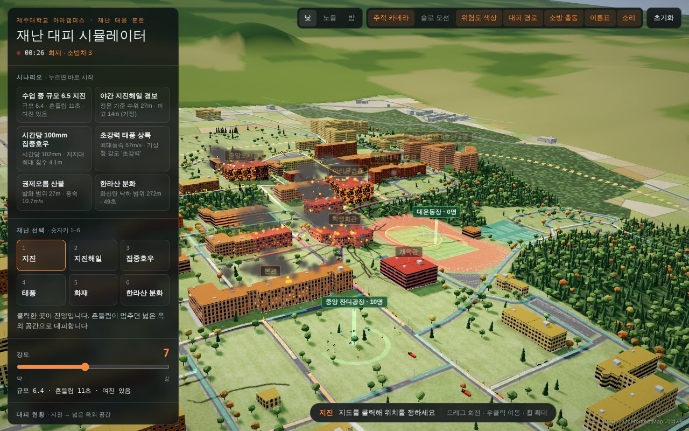
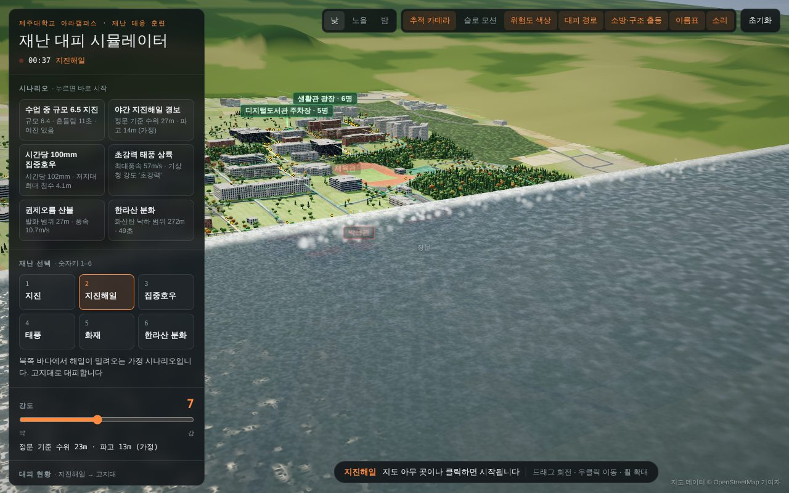
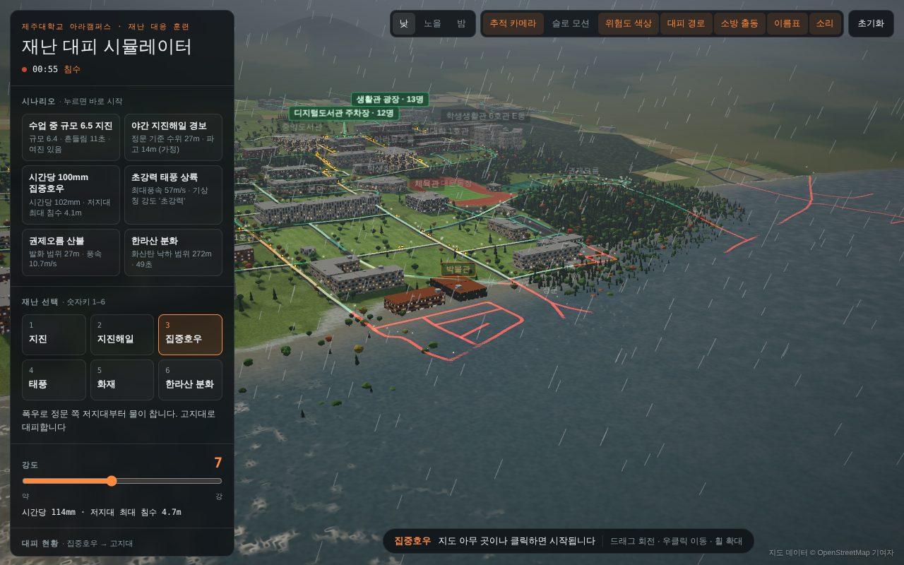
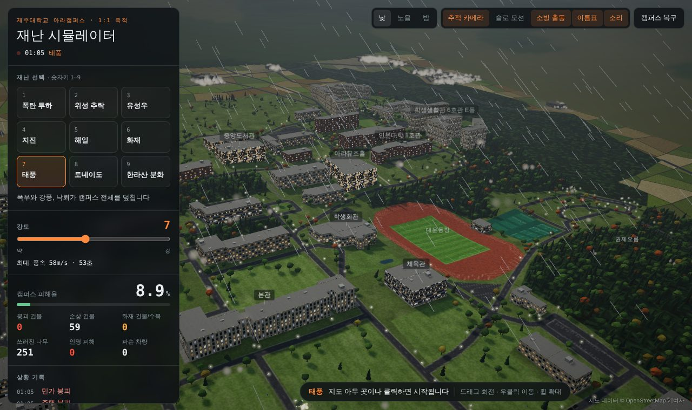
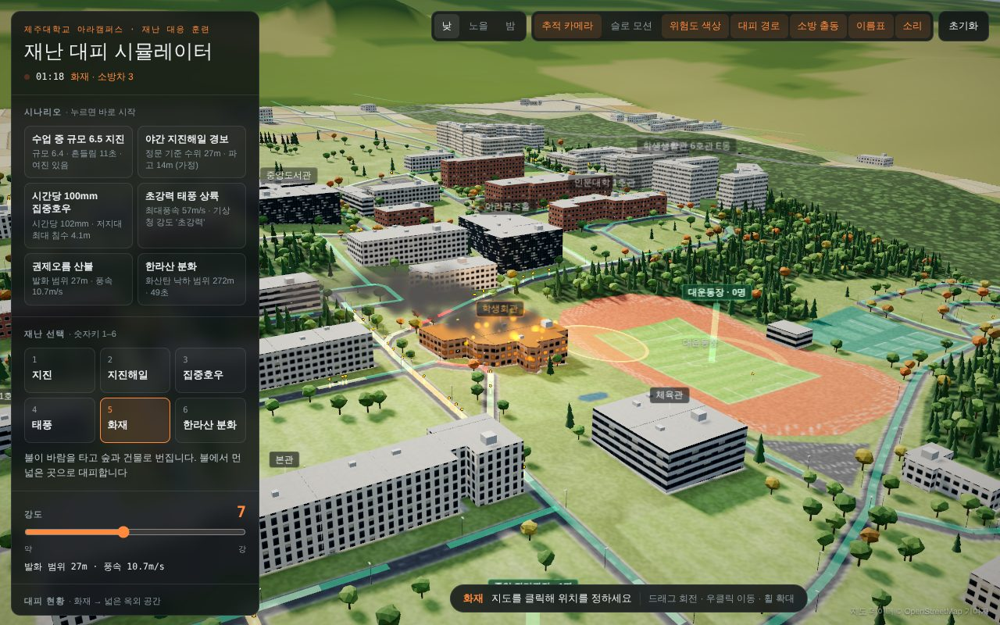
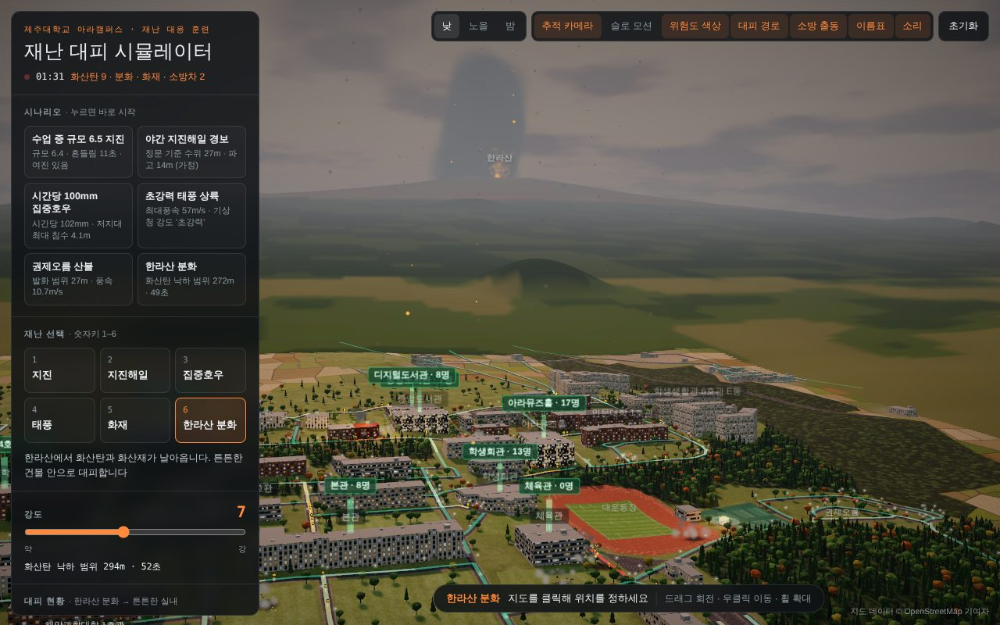
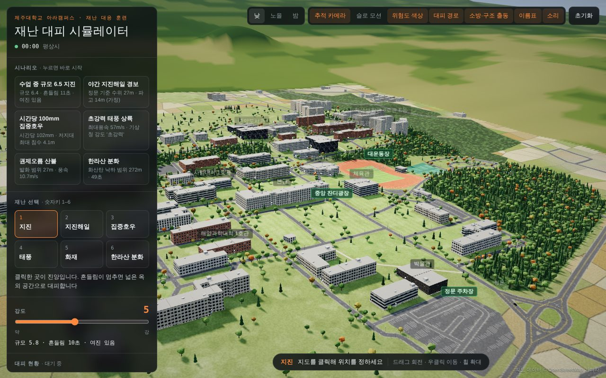
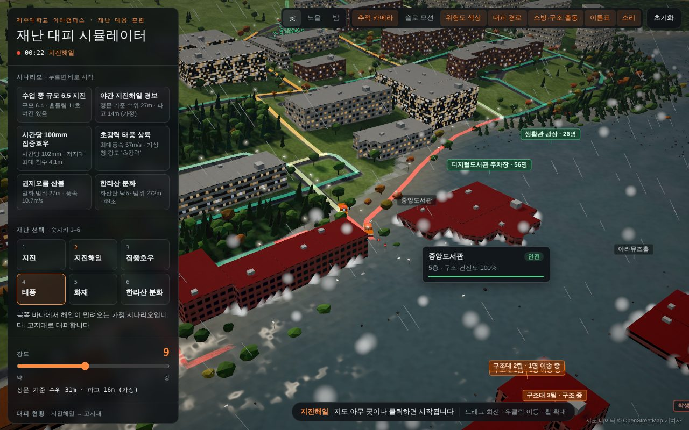
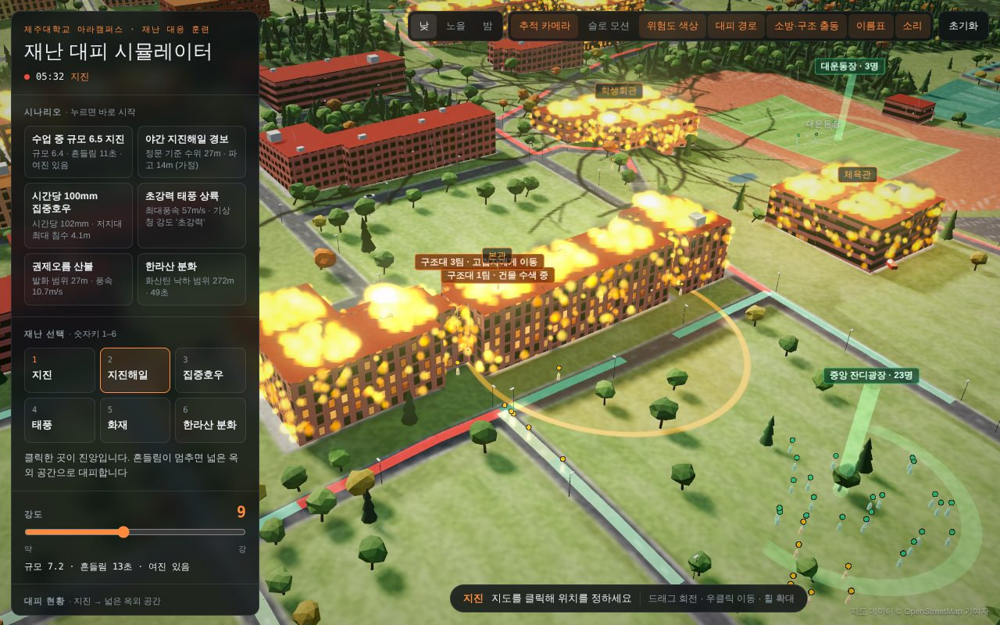
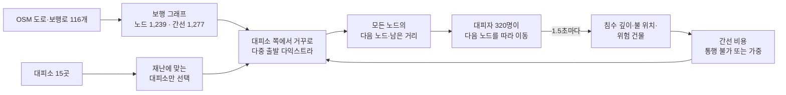

# 제주대 재난 대피 시뮬레이터

> **제주대학교 아라캠퍼스에서 재난이 나면 어디가 위험하고, 사람들은 어디로 어떻게 대피해야 하며, 대피는 얼마나 걸릴까?**

실제 건물·도로 배치(OpenStreetMap)와 실측 고도로 아라캠퍼스를 3D로 재현하고, 지진·지진해일·집중호우·태풍·화재·한라산 분화 6가지 재난에서 **위험한 건물을 색으로 표시**하고, 캠퍼스 사람들이 **실제 길을 따라 재난에 맞는 대피소로 이동하는 과정과 걸리는 시간**, 모든 재난에서 출동하는 **119 소방차·구조대가 불을 끄고, 물에 고립되거나 위험 건물에 갇힌 사람을 구조하는 과정**까지 보여주는 웹 시뮬레이터입니다. 설치 없이 브라우저에서 바로 실행됩니다.



| 지진해일 (가정) | 집중호우 침수 | 태풍 |
|---|---|---|
|  |  |  |
| **화재** | **한라산 분화** | **평상시 캠퍼스** |
|  |  |  |
| **119 구조대 (지진해일 고립자 구조)** | **119 구조대 (지진 때 위험 건물 수색)** | |
|  |  | |

---

## 1. 실행 방법

실행 플랫폼은 **웹 브라우저**입니다. 크롬 또는 엣지 최신 버전을 권장합니다 (WebGL 필요).

| 방법 | 하는 법 |
|---|---|
| **A. 웹에서 바로** | **https://gaogang1011.github.io/jnu-disaster-sim/** |
| **B. 파일로 (인터넷 없이도 동작)** | `Code → Download ZIP` → 압축 해제 → `index.html` 더블클릭 |
| **C. 로컬 서버 (Node.js 18+)** | `git clone https://github.com/gaogang1011/jnu-disaster-sim.git && cd jnu-disaster-sim && npm start` → http://localhost:8080 |

- three.js를 `vendor/three`에 포함해서 외부 CDN 없이 동작합니다. 인터넷이 없으면 글꼴만 시스템 글꼴로 바뀝니다.
- 빌드 단계가 없습니다. `npm start`도 Node 내장 모듈만 쓰는 정적 서버라 `npm install`이 필요 없습니다.
- 노트북 내장 그래픽에서 끊기면 `index.html?quality=low`로 여세요. 실행 중에도 프레임이 느려지면 연기·불꽃 양을 자동으로 줄입니다.

## 2. 30초 사용법

1. 로딩이 끝나면 왼쪽 위 **시나리오** 버튼 하나를 누릅니다. (예: "수업 중 규모 6.5 지진")
2. 건물이 **위험도 색**(노랑 주의·주황 경고·빨강 위험)으로 바뀌고, 사람(점)이 **초록 경로 띠**를 따라 **대피소**(초록 기둥)로 이동합니다.
3. 왼쪽 패널에서 **대피 완료율, 평균·최대 대피 시간, 고립·위험 노출 인원, 구조 인원**을 봅니다. 재난이 나면 바로 119에 신고되고, 5분(실제 환산) 뒤 **소방차(빨강)와 구조대(주황)**가 도착해 불을 끄고 고립자를 구조합니다.
4. **대피소 목록**에서 대피소를 꺼 보고 같은 시나리오를 다시 실행하면, 결과가 **실행 기록표**에 쌓여 비교할 수 있습니다.
5. 직접 해 보려면 재난(숫자키 `1`~`6`)과 강도를 고르고 지도를 클릭합니다. 클릭한 곳이 진앙·발화점이 됩니다.

| 조작 | 동작 |
|---|---|
| 왼쪽 클릭 | 선택한 재난 시작 (위치가 필요 없는 재난은 아무 곳이나) |
| 왼쪽 드래그 / 오른쪽 드래그 / 휠 | 회전 / 이동 / 확대 |
| 숫자키 1~6 | 재난 선택 |
| 건물 위에 마우스 | 이름·층수·구조 건전도·위험 등급·주원인·침수 깊이 |

오른쪽 위 토글: 낮·노을·밤, 추적 카메라, 슬로 모션, **위험도 색상**, **대피 경로**, **소방·구조 출동**, 이름표, 소리, 초기화.

## 3. 재난 6종과 대피 방식

강도 슬라이더(1~10)는 재난마다 **실제 단위**로 바뀌어 표시됩니다.

| 키 | 재난 | 강도의 실제 의미 | 대피 방식 | 대피 시작 |
|---|---|---|---|---|
| 1 | 지진 | 규모 4.0 + 0.35×강도 (4.4~7.5), 여진 포함 | 넓은 옥외 공간 | **흔들림이 멈춘 뒤** (그동안 제자리에서 몸 보호) |
| 2 | 지진해일 *(가정)* | 정문 기준 수위 3.8×강도 − 3.6m | 고지대 | 경보 즉시 |
| 3 | 집중호우 | 시간당 30 + 12×강도 mm, 저지대 침수 | 고지대 | 경보 즉시 |
| 4 | 태풍 | 최대풍속 22 + 3.5×강도 m/s → **기상청 강도**(중·강·매우 강·초강력) | 튼튼한 실내 | 즉시 |
| 5 | 화재 | 발화 범위와 풍속, 바람 방향으로 확산 | 불에서 먼 넓은 옥외 | 즉시 |
| 6 | 한라산 분화 | 화산탄 낙하 범위와 지속 시간, 화산재 | 튼튼한 실내 | 즉시 |

아라캠퍼스는 해발 약 36~124m여서 실제로 지진해일이 닿을 가능성은 매우 낮습니다. 지진해일은 고지대 대피를 연습하기 위한 **가정 시나리오**입니다.

### 대피소 15곳

| 대피 방식 | 대피소 |
|---|---|
| 넓은 옥외 공간 | 대운동장, 중앙 잔디광장, 정문 주차장, 동쪽 운동장, 골프 연습장 |
| 고지대 (정문보다 50m 이상 높음) | 생활관 광장, 디지털도서관 주차장, 동쪽 운동장, 골프 연습장 |
| 튼튼한 실내 | 중앙도서관, 학생회관, 체육관, 본관, 아라뮤즈홀, 디지털도서관, 공과대학 4호관, 의과대학 |

대피소는 OSM 지도에서 넓은 공터와 고지대, 큰 공공건물을 골라 정한 것으로, **학교가 공식 지정한 대피소 목록이 아닙니다.**

## 4. 어떻게 동작하나

### 위험도

건물 외곽선을 26m 격자로 나눈 구역마다 피해량을 누적하고 4단계로 바꿉니다. 건물을 무너뜨리는 대신 색과 표로 보여줍니다.

| 등급 | 조건 | 색 |
|---|---|---|
| 안전 | 피해 15% 미만 | 원래 외벽 |
| 주의 | 15~40%, 또는 침수 0.1m 이상 | 노랑 |
| 경고 | 40~70%, 또는 화재 중, 또는 침수 0.5m 이상 | 주황 |
| 위험 | 70% 이상 | 빨강 |

지진은 층수가 높을수록, 침수는 낮은 지대일수록, 강풍은 저층 주택일수록 피해가 큽니다. 지진 뒤에는 손상된 건물에서 가스 누출 화재가 날 수 있고, 불은 바람을 따라 번집니다. 위험 평가 패널에 등급별 건물 수와 위험 건물 상위 5개, 주원인이 나옵니다.

### 대피 경로



- **그래프**: 도로 꼭짓점을 노드로, 25m 넘는 구간은 잘게 나누고, 꼭짓점을 공유하지 않는 교차로를 위해 8m 이내 노드를 잇습니다. 캠퍼스 안 노드 677개 중 98% 이상이 대피소에 닿습니다.
- **탐색**: 열려 있는 대피소 전부를 출발점으로 한 번만 다익스트라를 돌려, 모든 지점에 "가장 가까운 대피소로 가는 다음 노드"를 기록합니다. 사람이 몇 명이든 탐색은 한 번입니다.
- **위험 반영**: 0.3m 넘게 잠긴 길과 불 15m 이내는 통행 불가, 얕은 물(×4)·불 40m 이내(×3)·위험 건물 옆 낙하물 구간(지진 때 ×5)은 돌아가게 됩니다. 1.5초마다 다시 계산해서 불이 번지거나 물이 차면 경로가 바뀝니다.
- **대피소 폐쇄**: 옥외 대피소가 잠기거나 불이 60m 안에 오면, 실내 대피소 건물이 불타거나 위험 등급이 되면 자동으로 닫히고 거기 있던 사람도 다른 곳으로 다시 대피합니다.

### 대피자

- 표본 320명(저화질 180명). 85%는 건물 출입구에서, 15%는 길 위에서 시작하고 건물 면적에 비례해 배치합니다.
- 반응 시간 0.5~3.5초 뒤 출발합니다. 지진은 흔들림이 멈출 때까지 제자리에서 몸을 보호합니다(행동요령 그대로).
- 보행 속도 1.4m/s(개인차 ±18%). 한 구간에 수용량(길이/3명)보다 많으면 최대 70%까지 느려지고, 많이 지나간 구간일수록 경로 띠가 노랑→빨강이 됩니다.
- 화면은 **시간을 10배 압축**합니다(화면 1초 = 실제 10초). 패널의 시간은 모두 실제 시간으로 환산한 값입니다.

### 고립과 119 대응

**고립**은 세 가지입니다. 한 번이라도 고립된 사람은 나중에 빠져나오거나 구조돼도 끝까지 "고립 경험"으로 기록되고, 고립된 시간도 누적됩니다.

| 고립 사유 | 언제 | 어떻게 풀리나 |
|---|---|---|
| 물 | 서 있는 곳이 0.5m 넘게 잠김 | 물이 0.2m 아래로 빠지면 스스로 대피, 또는 구조 |
| 길 막힘 | 물·불로 길이 모두 막혀 갈 수 있는 대피소가 없음 | 길이 다시 열리면 스스로 대피, 또는 구조 |
| 건물 안 | 몸 보호·반응 대기 중에 있던 건물이 위험 등급 3이 되거나 불이 붙음 (그 건물에서 출발할 사람의 20%) | **구조대만** 꺼낼 수 있음 |

**119 대응**: 재난이 시작되면 바로 신고가 들어가고, 5분(실제 환산, 가정) 뒤 소방차와 구조대 3팀이 정문·후문 중 물·불이 없는 쪽으로 도착합니다.

| 재난 | 소방차 | 구조대 |
|---|---|---|
| 지진 | 가스 화재 진압 | 위험 건물 수색·구조, 위험 건물 안전 점검 |
| 지진해일·호우 | (불이 없으면 대기) | 침수 고립자 구조 |
| 태풍 | 낙뢰 화재 진압 | 갇힘·고립자 구조, 위험 건물 안전 점검 |
| 화재 | 건물·수목 화재 진압 | 불에 갇힌 사람 구조 |
| 한라산 분화 | 화산탄 화재 진압 | 갇힘 구조, 위험 건물 안전 점검 |

- **구조대**는 고립자 구조 → 위험 건물(등급 2 이상) 안전 점검·출입 통제 → 대기 순으로 일합니다. 가장 가까운 고립자에게 가서(4m/s) 1분간 구조하고(건물 안 수색은 2분), 반경 30m 안 고립자를 최대 6명까지 태워 가장 가까운 열린 대피소로 옮깁니다.
- **소방차**는 최대 3대가 가장 가까운 건물·수목 화재로 가서 물을 뿌립니다. 주변 나무를 적셔 불이 번지지 않게 막습니다.
- 고립자가 남아 있고 구조대가 활동 중이면 실행이 끝나지 않습니다. **"소방·구조 출동"을 끄면** 신고·출동 없이 진행되어, 같은 재난을 켜고 끈 결과를 비교할 수 있습니다. 사망 상태는 만들지 않았습니다. 위험은 고립·위험 노출·구조 대기 시간으로 나타냅니다.

### 결과 지표

| 지표 | 정의 |
|---|---|
| 대피 완료율 | 대피소에 도착한 사람 / 전체 |
| 평균·최대 대피 시간 | 재난 발생부터 도착까지 (실제 시간 환산) |
| 고립 중 | 지금 물·길 막힘·건물 안 중 하나로 고립된 사람 (마우스를 올리면 사유별 인원, 실행 기록표의 "고립"은 끝까지 고립된 인원) |
| 고립 경험 | 한 번이라도 고립된 사람. 나중에 스스로 빠져나오거나 구조돼도 남음 |
| 평균 고립 | 고립 경험자가 고립 상태로 보낸 시간의 평균 |
| 구조 | 구조대가 태워 대피소로 옮긴 사람, 평균 구조 대기(처음 고립된 때부터 구조대가 태울 때까지) |
| 위험 노출 | 대피 중 0.2m 넘는 물이나 불 12m 이내를 지난 사람 |
| 진압·점검 | 소방차가 끈 건물 화재 수(수목은 그루 수), 구조대가 안전 점검한 위험 건물 수 |

모두 도착하거나(구조 포함), 구조대가 없을 때 남은 사람이 모두 고립되거나, 30분(실제 환산)이 지나면 한 번의 실행이 끝나고 **실행 기록표**에 한 줄이 쌓입니다.

## 5. 분석: 어느 대피소가 중요한가

`npm run analyze`는 시뮬레이터와 같은 그래프·경로 코드로 **캠퍼스 건물 59동에서 가장 가까운 대피소까지의 최단 거리**를 계산합니다(혼잡·위험 미반영, 건물 면적 가중). 전체 결과는 [docs/ANALYSIS.md](docs/ANALYSIS.md)에 있습니다.

| 조건 | 평균 거리 | 평균 도보 시간 | 가장 먼 건물 | 가장 붐비는 대피소 |
|---|---:|---:|---|---|
| 옥외 5곳 모두 | 388m | 4분 37초 | 인재양성관 853m | 중앙 잔디광장 50% |
| 대운동장 사용 불가 | 390m | 4분 38초 | 인재양성관 853m | 중앙 잔디광장 53% |
| **중앙 잔디광장 사용 불가** | **465m** | **5분 32초** | 인재양성관 853m | 골프 연습장 42% |
| 대운동장 한 곳만 | 759m | 9분 02초 | 학생생활관 2호관 A동 1,329m | 대운동장 100% |
| 고지대 4곳 모두 | 425m | 5분 03초 | 원자력과학기술연구소 1,154m | 디지털도서관 주차장 43% |
| 실내 8곳 모두 | 198m | 2분 22초 | 원자력과학기술연구소 552m | 본관 33% |

- 옥외 대피 인원의 절반이 **중앙 잔디광장**으로 몰립니다. 잔디광장을 쓸 수 없으면 평균 거리가 20% 늘지만, 대운동장이 막혀도 거의 차이가 없습니다. 캠퍼스 중앙의 넓은 잔디밭이 지진 대피의 핵심 공간이라는 뜻입니다.
- "넓은 곳 = 대운동장" 한 곳만 떠올리면 평균 거리가 두 배(759m)가 되고, 생활관 쪽에서는 15분 넘게 걸립니다. 대피소를 여러 곳으로 나눠 알려야 하는 이유입니다.
- 고지대 대피는 북쪽 저지대 건물(원자력과학기술연구소, 박물관 일대)에서 1km 넘게 걸어야 합니다. 이 구역은 지진해일·호우 때 대피를 가장 먼저 시작해야 합니다.

### 지진해일 고립·구조 실험

지진해일 강도 9(정문 기준 수위 31m, 가정)를 처음부터 끝까지 진행했을 때의 결과입니다(저화질 표본 180명).

| 항목 | 결과 |
|---|---|
| 고립 경험 | 46명 |
| 구조대 도착 | 첫 고립 약 5분 뒤, 정문이 잠겨 **후문**으로 도착 |
| 구조 | 5명, 평균 구조 대기 약 7분 |
| 나머지 고립자 | 41명은 물이 빠지기 시작한 뒤 스스로 대피 |
| 최종 | 완료율 100%, 평균 대피 8분, **최대 25분 38초** |

- 구조대 3팀이 한 번에 태울 수 있는 인원보다 고립자가 훨씬 많고, 고립자가 넓게 흩어져 있어 구조로 해결되는 비율은 10% 남짓입니다.
- 물은 북쪽에서 밀려오므로 고립은 고지대 대피소까지 거리가 먼 저지대에서 생깁니다. 구조대는 첫 고립 뒤 5분이 지나야 도착하므로, **구조를 기다리는 것보다 경보 즉시 고지대로 출발하는 것이 결정적**이라는 행동요령과 같은 결론입니다.

## 6. 행동요령과 출처

재난을 고르면 패널 아래에 해당 행동요령 카드가 나옵니다. 내용은 다음 공식 자료를 요약했습니다.

- 지진: [서울안전누리 지진대피 요령(행정안전부 제공)](https://news.seoul.go.kr/safe/SeoulEqk/html/home/community/prevent.jsp), [K-water 국민행동요령](https://www.kwater.or.kr/safety/sub03/natu02Page.do?s_mid=1942)
- 지진해일: [행정안전부 지진해일 행동요령 보도](https://www.koreatimenews.com/news/article.html?no=869994)
- 화산: [국민안전24 화산폭발 시 국민행동요령](https://www.safekorea.go.kr/safekorea-kor/em/emergency/emergency_er5.html)
- 태풍 강도 분류: [기상청 태풍 강도](https://www.weather.go.kr/wnuri_help/html/typhoon/report.jsp?menu=1)
- 호우·태풍·화재 일반 행동요령: [국민재난안전포털](https://www.safekorea.go.kr/)

## 7. 캠퍼스 재현 방식

| 요소 | 출처 | 정확도 |
|---|---|---|
| 건물 84동 외곽선·위치·이름, 도로 116개, 숲·잔디·주차장·운동장 | OpenStreetMap | 실제 |
| 지형 고도 | 41×41 고도 격자 (1.7km 범위, 약 42m 간격) 보간 | 실측 기반 |
| 건물 높이 | 이름으로 추정 (생활관 5~9층, 강의동 3~5층 등) | **추정** |
| 나무 위치, 캠퍼스 밖 풍경 | 생성 | 연출 |

지도 데이터 © [OpenStreetMap 기여자](https://www.openstreetmap.org/copyright) (ODbL)

## 8. 구조

```
jnu-disaster-sim/
├─ index.html            진입점 (vendor → src 순서로 스크립트 로드)
├─ css/style.css
├─ src/
│  ├─ 00-data.js         OSM 캠퍼스 데이터
│  ├─ 00-guides.js       대피소 15곳, 행동요령·출처, 태풍 강도 분류
│  ├─ 01-util.js         다각형·노이즈·난수·최소 힙
│  ├─ 02-core.js         렌더러, 카메라, 시간대, 하늘, 후처리
│  ├─ 02-route.js        보행 그래프, 다중 출발 다익스트라 (브라우저 의존성 없음)
│  ├─ 03-terrain.js      지형, 지표 텍스처, 지면 피킹
│  ├─ 04-buildings.js    건물, 피해 누적, 위험 등급·색, 화재
│  ├─ 05-vegetation.js   수목, 가로등, 산불 확산
│  ├─ 06-particles.js    불꽃·연기 파티클
│  ├─ 07-debris.js       파편
│  ├─ 08-agents.js       차량, 소방차
│  ├─ 09-sound.js        Web Audio 절차적 사운드
│  ├─ 10-environment.js  물, 비, 번개, 화산
│  ├─ 11-evacuation.js   대피자, 경로 비용, 대피소 개폐, 고립 기록, 지표
│  ├─ 11-rescue.js       119 구조대 출동·구조·이송
│  ├─ 12-disasters.js    재난 6종과 등록표 DISASTERS
│  └─ 13-main.js         패널 UI, 입력, 카메라, 메인 루프
├─ vendor/three/         three.js r128
├─ scripts/              serve(npm start) · bundle(단일 HTML) · analyze(대피 거리 분석)
├─ test/                 data · route · structure (Node), e2e (헤드리스 크롬)
├─ docs/                 DESIGN.md(설계), ANALYSIS.md(분석), screenshots
├─ SKILL.md              이 저장소를 다루는 AI 에이전트용 스킬
└─ TODO.md               단계별 진행표
```

`src/*.js`는 모듈 번들러 없이 일반 `<script>`로 파일명 순서대로 로드되고 전역 스코프를 공유합니다. 파일을 내려받아 더블클릭만 해도 실행되는 대신, 파일 사이 이름이 겹치지 않아야 합니다(구조 테스트가 검사).

기술: three.js r128(렌더링·인스턴싱·셰이더·블룸), Canvas 2D(지표·외벽 텍스처 생성), Web Audio API(음원 파일 없는 소리 합성), 순수 JavaScript.

## 9. 테스트

```bash
npm test              # Node 테스트 19건, 외부 패키지 없음
npm install && npx playwright install chromium
npm run test:e2e      # 헤드리스 크롬 동작 테스트
npm run screenshots   # 위 테스트 + docs/screenshots 갱신
npm run analyze       # docs/ANALYSIS.md 다시 만들기
```

**Node 테스트 (19건)**

- 데이터(11): 건물 다각형 유효성, 주요 건물 위치, 고도 격자, 분할 면적 보존, 대피소가 캠퍼스 안 빈 땅에 있는지, 실내 대피소 건물 존재, 행동요령 출처, 태풍 강도 경계값
- 경로(6): 간선 길이, 연결성, 옥외·고지대 대피소 도달률 90% 이상, 경로를 따라 남은 거리가 줄어드는지, 막힌 간선 우회
- 구조(2): `index.html` 스크립트 순서, 파일 사이 최상위 이름 중복 금지

**브라우저 동작 테스트**: `index.html`을 파일로 직접 열고 네트워크를 모두 차단한 상태에서 로딩, 실제 마우스 클릭, 재난 6종(시작 로그·대피 방식·이동/도착·위험 건물·침수·화재), 대피소를 하나만 남겼을 때 그곳으로만 가는지, 실행 기록표, 고립 기록과 구조대 구조, 시나리오 버튼, 초기화, 스크립트 오류를 검사합니다.

최근 실행 결과 (헤드리스 크롬, 저화질 모드 표본 180명):

```
PASS  페이지 로드와 초기화
PASS  건물 84동·보행 그래프·대피소 15곳 생성 — 노드 1239, 표본 180명
PASS  지도 클릭으로 지진과 대피 시작
PASS  재난: quake — 대피 방식 open, 이동·도착 180/180, 위험 건물 57, 도착 22명
PASS  재난: tsunami — 대피 방식 high, 이동·도착 178/180, 침수 구역 18
PASS  재난: rain — 대피 방식 high, 이동·도착 180/180, 침수 구역 4
PASS  재난: typhoon — 대피 방식 indoor, 이동·도착 180/180, 도착 69명
PASS  재난: fire — 대피 방식 open, 이동·도착 180/180, 화재 구역 6
PASS  재난: volcano — 대피 방식 indoor, 이동·도착 180/180
PASS  실행 기록표에 결과가 쌓임
PASS  대피소를 끄면 남은 대피소로만 대피 — 도착 7명 → 학생회관
PASS  고립자 기록과 구조대 구조 — 고립 경험 45명, 구조 3명, 평균 구조 대기 436초 (재난 후 10분)
PASS  시나리오 버튼 (야간 지진해일)
PASS  초기화
PASS  실행 중 스크립트 오류 없음

15/15 통과
```

재난마다 정해진 짧은 시간(화면 8~26초)만 진행한 뒤 검사하므로 도착 인원은 일부입니다. 구조 검사는 수십 초가 걸리므로 렌더링 없이 시뮬레이션을 직접 진행해 첫 이송이 시작될 때까지 확인합니다. README의 스크린샷은 모두 이 테스트가 찍은 화면입니다.

## 10. 개발 과정

바이브 코딩으로 만들었고, [TODO.md](TODO.md)의 단계마다 커밋하고 푸시했습니다. 커밋 메시지는 `유형: 요약` + 본문(이유·변경 목록·확인 결과)으로 썼습니다.

1. **1차 (1~10단계)**: 아라캠퍼스 3D 재현과 재난 9종 체험형 시뮬레이터
2. **방향 전환**: 파괴를 보여주는 체험은 과제로서 의미가 약하다고 판단해, "어디가 위험하고 어디로 대피하는가"를 보여주는 도구로 바꾸기로 하고 [설계 문서](docs/DESIGN.md)를 먼저 작성
3. **2차 (11~19단계)**: 공격·비현실 시나리오 제거, 집중호우 추가, 위험도 평가, 보행 그래프와 대피 경로, 대피 시뮬레이션, 시나리오·행동요령·실행 기록, 테스트·분석
4. **3차 (20~22단계)**: 고립됐다가 물이 빠져 걸어 나온 사람이 결과에 "무사히 도착"으로만 남는 문제를 발견해, 고립 경험·고립 시간을 누적 기록하고 119 구조대 모델을 추가
5. **4차 (23~26단계)**: 구조대가 물 고립 때만 나와 지진·태풍·화산에서는 보이지 않는 문제를 고쳐, 모든 재난에서 119가 바로 출동하고 재난별로 진압·수색·안전 점검을 하도록 바꾸고, 위험 건물 안에 갇히는 고립 유형을 추가

### 개발 중 해결한 문제

| 문제 | 원인 | 해결 |
|---|---|---|
| 화재가 나면 화면이 멈춤 | 대피 모듈의 `nearestFire`가 소방차의 같은 이름 함수를 덮어씀 (전역 스코프 공유) | 이름 변경, 파일 사이 이름 중복을 검사하는 테스트 추가 |
| 대피자와 경로가 화면에서 안 보임 | 사람 모형은 1.7m라 전경에서 1픽셀 미만, WebGL 선은 1픽셀이라 지형에 묻힘 | 화면 크기 고정 상태색 점, 땅 위 3m 폭 경로 띠 |
| 지진 규모 6.4에서 거의 모든 건물이 위험 | 1차 버전의 파괴용 피해 계수 | 계수를 낮춰 등급이 고르게 나뉘게 조정 |
| 집중호우가 캠퍼스 건물에 닿지 않음 | 침수 깊이가 정문 높이 근처에서 끝남 | 저지대 최대 침수 깊이 상향 |
| 건물 외벽이 검게 렌더링 | 환경맵(PMREM) 생성 오류 | 환경맵 제거, 반구광 보정 |
| 파일로 열면 클릭이 안 됨 | 투명해진 로딩 화면이 지도를 덮음 | 로딩 완료 시 `hidden` 처리 |
| 고립됐다 빠져나온 사람이 "도착"으로만 기록 | 고립을 현재 상태로만 셈 | 고립 경험·누적 고립 시간을 따로 기록 |
| 구조대가 도착하면 이미 물이 빠져 있음 | 최고 수위 유지가 8초(실제 1분 남짓)로 너무 짧음 | 지진해일 45초·호우 50초(실제 7~8분)로 늘림 |
| 지진·태풍·화산에서 구조대가 안 보임 | 고립자가 생길 때만 출동, 고립은 거의 물에서만 생김 | 재난 직후 출동, 안전 점검 임무와 건물 안 갇힘 추가 |
| 화재 재난에서 소방차가 하나도 못 끔 | 5분 뒤 도착하는 동안 불이 다 타고, 소방차는 건물 불만 끄고 느렸음 | 구조대와 같은 속도, 수목 화재 진압·주변 나무 적시기 |

### SKILL.md

[SKILL.md](SKILL.md)는 AI 코딩 에이전트가 이 저장소를 다룰 때 읽는 스킬 파일입니다. 앱의 목적(파괴가 아닌 대피), 빌드 없는 전역 스크립트 구조의 규칙과 실제로 겪은 이름 충돌 사례, 모듈별 주요 함수, **새 재난을 추가하는 9단계 절차**(행동요령·대피소·피해·경로 비용·등록표·테스트), 대피 모델을 고칠 때 지킬 것, 검증 명령, 커밋 규칙을 담았습니다. 사람이 읽어도 기여 가이드로 쓸 수 있습니다.

## 11. 한계

- 피해와 대피는 교육용 단순 모델입니다. 실제 내진 성능·구조 해석이나 공식 대피 계획을 대신하지 않으며, 실제 안전 판단에 쓰면 안 됩니다.
- 대피소는 지도에서 고른 후보이며 학교 공식 지정 대피소가 아닙니다.
- 건물 높이는 추정값이고, 건물 내부 계단·복도는 표현하지 않습니다(건물 출입구에서 출발).
- 보행 그래프는 OSM에 그려진 길만 씁니다. 지도에 없는 샛길·잔디밭 가로지르기는 반영되지 않습니다.
- 시간은 10배 압축이고 반응 시간은 단순 분포입니다.
- 119 도착 시간 5분, 건물 안 갇힘 20%, 구조·수색 시간은 가정값입니다. 소방차·구조대는 도로가 아니라 직선으로 이동합니다.
- 구조대는 길을 따르지 않고 직선으로 이동하며(보트·차량 가정), 출동 시간과 팀 수는 고정값입니다. 사망·부상은 다루지 않고 고립·위험 노출로만 나타냅니다.

## 12. 문제 해결

| 증상 | 해결 |
|---|---|
| "WebGL을 쓸 수 없습니다" | 크롬 설정 → 시스템 → "가능한 경우 그래픽 가속 사용"을 켜고 재시작 |
| 로딩 화면에서 멈추고 "실행 오류" 표시 | 저장소 전체(`vendor/`, `src/`, `css/`)를 받았는지 확인 |
| 메신저·메일 미리보기에서 안 움직임 | 미리보기는 스크립트를 막습니다. 파일을 저장한 뒤 브라우저로 열기 |
| 끊김 | `index.html?quality=low`, 슬로 모션 끄기 |

## 13. 라이선스

- 코드: MIT ([LICENSE](LICENSE))
- 캠퍼스 지도 데이터: © OpenStreetMap 기여자, ODbL
- three.js: MIT ([vendor/three/LICENSE](vendor/three/LICENSE))
